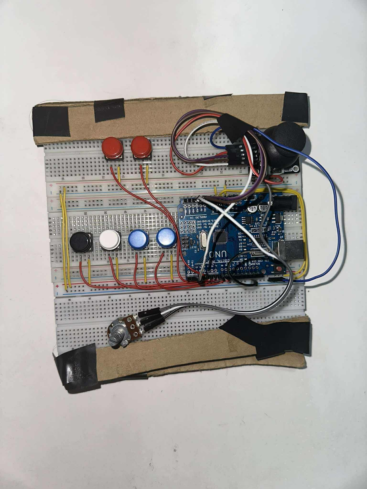
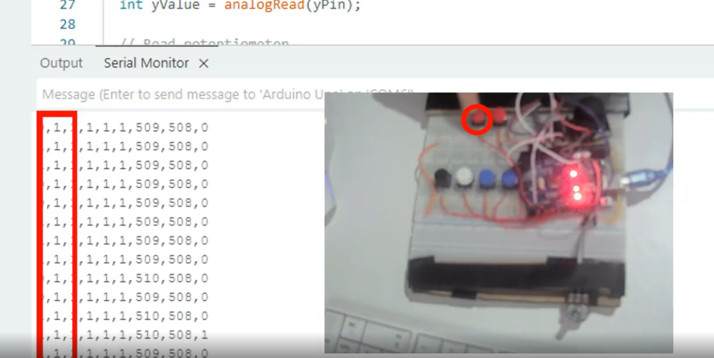
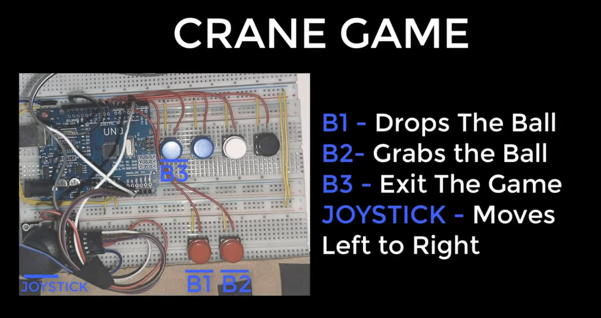
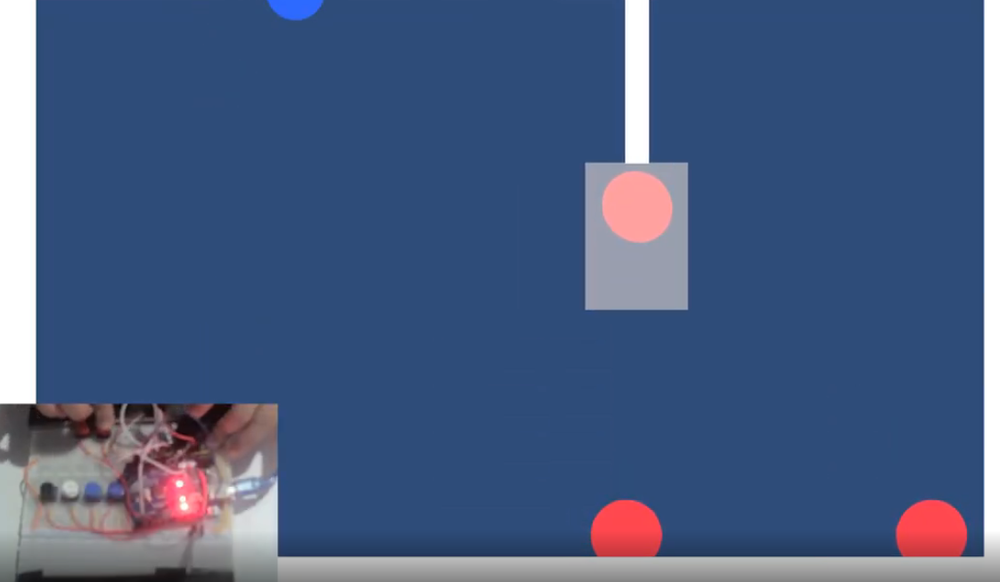
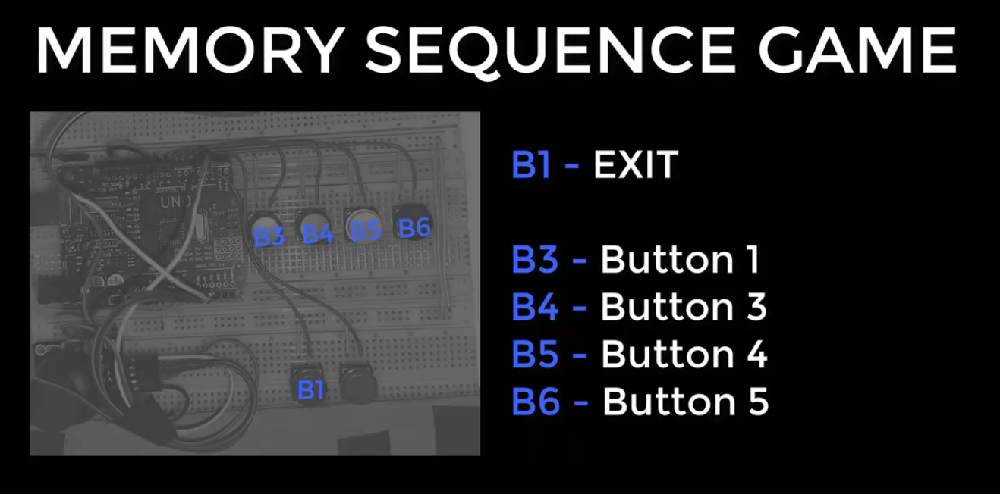
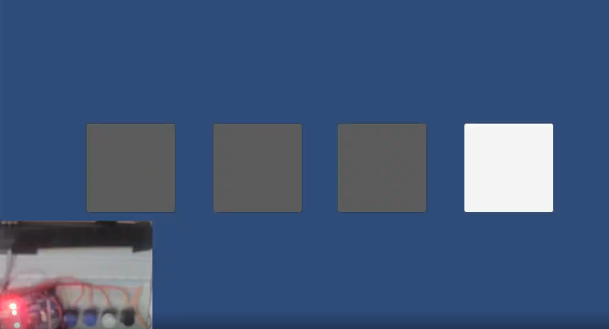
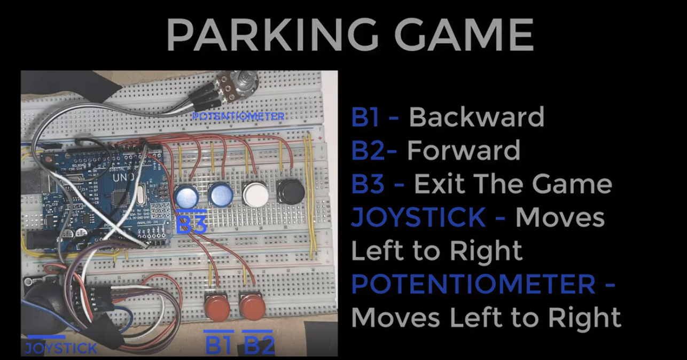
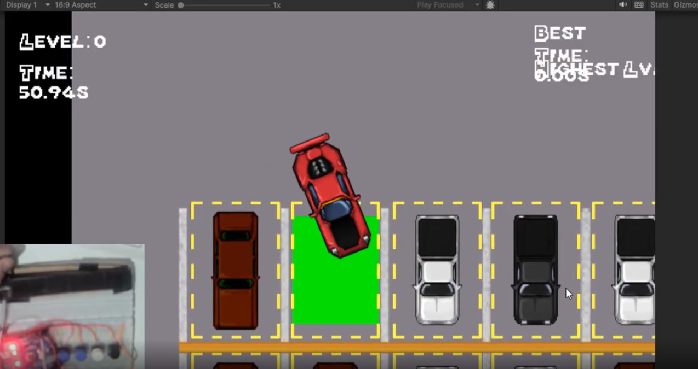

# Jamari's Arduino Controller

A Computer Architecture project connecting a custom Arduino controller to a Unity application. The prototype explores affordable, customizable game interaction through serial communication.

## About the project

Built at Mapúa University, the controller uses an Arduino Uno R3, six push buttons, a dual-axis joystick, and a potentiometer for steering. The two main buttons and four additional buttons provide inputs that vary between games. Arduino reads the controls and sends their values over USB serial for Unity to interpret.

## Games

### Crane game

Move the crane with the joystick and use the buttons to drop or grab the ball.

### Memory sequence

Watch the sequence and repeat it using the four buttons.

### Parking game

Use the buttons to move forward and backward and the analog controls to steer.

## Opening the project

1. Clone this repository and add its folder to Unity Hub.
2. Open it with Unity **6000.0.54f1** and allow Unity to import the assets.
3. Connect the Arduino controller over USB. Hardware input requires the appropriate Arduino firmware and serial port configuration; check the project scripts for the expected port and baud rate.

## Team

Adyson Reales (leader), Matteo De Leon, John Kerby Gadiano, Richard Imus, Adrian Muros, Karl Evlan Robasto, Jared Saflor, and Darrelle Yuri Soriano.
